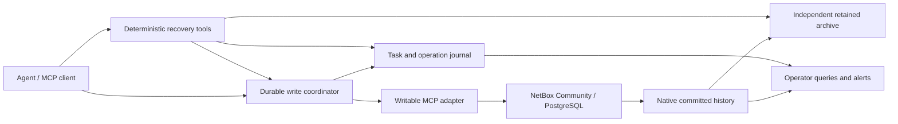

Recommended practices for agentic NetBox edits
==============================================

This handoff is based on the executable [spike lab](../lab/README.md), [research](../research/audit-and-undo.md), and [runtime findings](../research/spike-findings.md). The recommended starting architecture is an existing writable MCP adapter behind a durable write coordinator, NetBox native history, an independent archive, and a deterministic recovery service. Retain PostgreSQL. Ordinary edits and supported corrective changes can run without human approval.

The patched `netbox-sdk` was the most useful integration candidate in these experiments because it exposed HTTP receipts and accepted concurrency headers. The unmodified inspected commit has a reproducible MCP write bug; the [small Apache-2.0 patch](../lab/patches/sdk-mcp-locals.patch) is required for the tested integration. Zenix worked for simple CRUD with less configuration, but its exposed write schema lacks a precondition/header input. nbox worked for its constrained plan/apply path. These are bounded experiments, not comprehensive production endorsements.

**Architecture and ownership.** Put the coordinator at the write boundary so task identity and evidence capture do not depend on the model remembering to call a logging tool. Do not expose an unrestricted alternate write route to the agent. Assign separate identities to agent operations, human edits, and archive readers. Apply NetBox object permissions and supported-operation restrictions; trust in the agent does not replace concurrency control or explain failures after timeouts.

The prototype demonstrates this arrangement using SDK MCP for writes and independent REST reads for history. It does not supply a production multi-user gateway, durable scheduler, access-controlled archive service, or transactional deduplication plugin.

**Perpetual history is a storage contract.** Configure `CHANGELOG_RETENTION=0` and verify effective configuration, housekeeping behavior, and permissions after every upgrade. Preserve native committed before/after snapshots, object type/identity, action, actor, timestamp, request ID, instance/restore lineage, and source versions. Archive raw evidence before deriving searchable or REST-ready representations. Archive every writer's history, including UI and independent REST edits; otherwise conflict detection is incomplete.

Keep the operation journal as well as ObjectChange. It records intent, unsuccessful requests, uncertain outcomes, and successful no-ops that may have no native change record. Store intent durably before sending. Store receipts separately from committed evidence. A suitable operation state model distinguishes not-yet-dispatched intent, dispatched/uncertain, explicit failure, success with receipt but evidence pending, committed-with-evidence, and confirmed no-op. Do not label missing evidence as a no-op solely because current values happen to match.

Give the production archive an identity that can append but cannot delete existing evidence. Retain backups outside the application host and administrative failure domain. Define encryption, access to old field values, capacity growth, and a funded retention owner. Hash manifests support corruption detection; they are not tamperproof if an administrator can replace both records and hashes. Set and measure archival lag and backup recovery objectives. No finite test establishes indefinite durability.

The prototype rescans all history and deduplicates by lineage plus native ID, detecting changed historical payloads. This is intentionally simple and was tested for replay and restore. For larger installations, use an overlapping incremental export with durable checkpoints plus periodic full reconciliation. A monotonically increasing ID alone is unsafe as a permanent checkpoint when transactions can commit out of order. Validate late records, pagination interruptions, concurrent exports, and retention/permission gaps before claiming complete incremental capture.

**Correlation and exactly-once limits.** Assign task and operation UUIDs on the service side. One task may span multiple NetBox request UUIDs. The spike verified that a `changelog_message` operation marker can correlate an actual change after its HTTP response is lost. Require matching instance, actor, object/type, action, and receipt when available. Never match solely on time proximity or current values. Operation markers are not authorization credentials and can be copied by another privileged writer.

An external coordinator cannot atomically commit its journal and NetBox's mutation. A lost response with no surviving change marker must remain uncertain. A successful no-op may leave no native change record even with a message. If the next project needs durable receipts and deduplication for *every* attempted command, build a small NetBox plugin endpoint that validates the request, records operation ID and request fingerprint, applies the mutation, and stores its result in the same database transaction. Uniqueness must prevent replay with the same key and different intent. Test this independently; this spike did not implement that plugin.

**Recovery as a new change.** Preserve the original mistake and link a corrective task to it. Calculate inverses in deterministic code from committed snapshots, with per-model serialization rules. The tested automatic surface is scalar device description, serial, asset tag, and status. Null and empty values remain distinct. Tags, custom-field maps, relations, and arbitrary plugin models need explicitly tested conversion and merge semantics before inclusion.

A current field value equal to the original after-value is insufficient: the field may have changed away and back. Examine intervening retained history and current state. Preserve unrelated later edits. Read an ETag, evaluate the inverse against current evidence, and apply with `If-Match`. Verify the exact endpoint rechecks under a transaction lock. The tested NetBox 4.6.10 detail update passed both stale-header and simultaneous-writer tests; the scalar recovery also passed on 4.7.1. Do not extend this result to arbitrary bulk/plugin endpoints.

Reversing creates or deletes requires dependency analysis. A newly created object may have been repurposed or gained dependents. Deleting the tested interface also deleted its assigned IP address. Recreating the interface yielded a different ID; restoration must recreate missing dependent objects and explicitly remap their relationships. Use supported lifecycle states instead of hard deletion where recovery coverage is absent. Otherwise classify the operation as assisted/manual restoration. Restore backups to a separate instance, extract the relevant graph, map identities, and validate it before applying selective corrections. Rewinding the whole production database would lose unrelated later work.

Task-wide compensation is not atomic rollback. Define dependency order, partial success, interruption, and restart behavior. The prototype deduplicates individual correction requests and refuses unsafe inverses; it does not implement generalized repeated-field task undo, automatic retry of failed corrections, or graph reconstruction. These remain downstream engineering work.

**Observability and recovery runbooks.** Operators must be able to answer what a task changed, what changed an object/field, which writes are uncertain, which committed receipts lack history, and which corrections failed. The [journal CLI](../lab/journal_cli.py) demonstrates these queries without relying on the model's explanation. Emit metrics for archival age, reconciliation gaps, oldest unresolved operation, correction conflicts/failures, and backup restore age. The lab exposes archival freshness and failures as structured data; production monitoring delivery and on-call ownership still need integration.

| Trigger | Required response |
|---|---|
| Response lost or process dies after dispatch | Reconcile durable intent against committed evidence; do not retry a create/allocation blindly |
| Archive unavailable | Apply the configured write policy; expose outage/lag immediately and replay export after restoration |
| Same-field conflict or stale precondition | Preserve current data; refresh evidence and report conflict rather than overwrite |
| Live history missing | Use retained archive/backup, report the gap, and establish why the live source lost records |
| Historical payload changes after upgrade | Preserve both versioned representations; inspect the migration; do not overwrite the original archive |
| Database restored to an earlier point | Assign a new restore lineage before accepting reused IDs or resuming journal reconciliation |
| Unsupported deleted graph | Restore into an isolated instance and plan model-specific identity/dependency reconstruction |
| Correction emitted webhooks | Identify downstream consumers and handle their effects separately |

Choose an explicit outage policy. The prototype tests both recording committed-but-unarchived receipts and refusing new writes when archival preflight fails. Even a successful preflight cannot guarantee the archive remains available during the subsequent write. Zero-loss write/receipt capture needs transactional design plus durable database backups.

**AI guidance and enforcement.** Start with the [agent instructions](agent-instructions.md), but enforce supported operations, permissions, concurrency, and recovery calculation in code. The tested small local model made protocol, workflow, and reporting mistakes even when the tools preserved data. A constrained response schema improved parsing but did not establish reliable judgment or completion.

Use a bounded runner with a maximum call count and detection of repeated identical refusals. Have application code attach authoritative evidence IDs and correction status to the final response. Allow the model to explain conflicts and propose next steps, while the tool decides whether a correction is supported. Keep evidence text separate from instructions. Evaluate misleading descriptions, uncertain requests, unsupported deletes, and partial execution with the actual chosen model/runtime. Do not infer model safety from deterministic API tests or from a single successful example.

**Adoption gates.** Before deploying, the downstream project should pass the [acceptance scenarios](../research/spike-plan.md) for its exact NetBox/plugins, roles, adapter commit, model, and supported operation set. Establish off-host archive/backup restore drills, enforce a minimum supported NetBox version, define retention ownership and outage policy, and close the no-op/deduplication requirement if it is mandatory. Add model-specific coverage gradually; an explicit unsupported result is preferable to an unverified inverse.

The lab used open-source primary components, source/image/model pins, and dependency license metadata. It required no proprietary hosted service. Preserve licenses for redistributed artifacts and review exact deployment dependencies; the metadata inventory is not a complete base-image/package legal audit.
