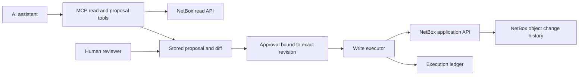

NetBox maintenance by AI — options assessed on 2026-09-28

**Recommendation: keep NetBox Community on PostgreSQL and put a reviewable change-proposal layer in front of its write API.** Use MCP to read, prepare changes, and submit proposals. Give production write credentials to a separate executor that applies only the exact approved proposal. This provides the requested review and audit behavior without adopting a restricted plugin or replacing the database.

Before building the proposal layer, evaluate **NetBox AI Navigator** if working inside NetBox's browser UI is acceptable: it already implements an open-source proposal/confirmation workflow. For MCP specifically, evaluate a limited-operation pilot using `nbox`. Git-reviewed YAML/JSON with a reconciler is the strongest durable-review alternative. For broader CRUD adapters, `netbox-sdk` and `netbox-mcp-server-extended` merit evaluation. These are recommendations from the evidence below, not claims of tested deployments.

Assumptions: retain NetBox; self-host the operational stack; no Cloud/Enterprise dependency; accept permissive and copyleft open-source licenses; human approval is desirable; arbitrary cross-model database transactions are optional unless required by the eventual workflow. The deployed NetBox version, plugins, inventory size, and initial write types have not been supplied.

**The licensing constraint eliminates several otherwise attractive solutions.**

| Component | License evidence | Result for this project |
|---|---|---|
| NetBox Community | Apache-2.0 | Eligible foundation. |
| Official NetBox MCP server | Apache-2.0 in inspected source | Eligible, but read-only. |
| Official NetBox Branching | Current NetBox Limited Use License 1.0 | Exclude: internal-use, redistribution, and competitive restrictions conflict with the stated requirement. |
| Earlier NetBox Branching | Initial license was PolyForm Shield 1.0.0 | Exclude: its noncompete restriction is not an open-source alternative. I found no Apache-era base in the inspected license-file history. |
| `antoinekh/netbox-change-control` | MIT | Its own license qualifies, but it requires restricted NetBox Branching. The combined solution fails the requirement. |
| `KPTheProf/netbox-branch-guard` | Apache-2.0 | Same dependency problem; also provides write restrictions rather than a complete review system. |
| `netbox-branch-review` | MIT package metadata | Its branch merge workflow also requires NetBox Branching; exclude the combined stack. |
| Official NetBox Change Management | Vendor feature built on Branching | Exclude from the eligible shortlist. A Community availability badge is not proof of an open-source license. |
| Diode ingestion service | NetBox Limited Use License in inspected source | Exclude the current service. SDK or connector licensing cannot make the required service open source. |
| Dolt / Doltgres | Apache-2.0 projects | License is suitable; NetBox integration maturity is the issue. |

Primary evidence: [NetBox licensing](https://netbox.readthedocs.io/en/stable/development/), [Branching current license](https://github.com/netboxlabs/netbox-branching/blob/main/LICENSE.md), [original Branching license](https://github.com/netboxlabs/netbox-branching/blob/d96a6a977463a6af9ba84f9736fee532d73e98f8/LICENSE.md), [license change history](https://api.github.com/repos/netboxlabs/netbox-branching/commits?path=LICENSE.md), [community change control](https://github.com/antoinekh/netbox-change-control), [branch guard](https://github.com/KPTheProf/netbox-branch-guard), [branch review package](https://pypi.org/project/netbox-branch-review/), [official change management](https://netboxlabs.com/docs/changes/), and [Diode license](https://github.com/netboxlabs/diode/blob/054e7afbbc173f7ac70265ea699ff8fa1fbfe9f9/LICENSE.md).

This distinction matters: free use, public source, and inclusion in a community installation do not establish open-source eligibility. Pin licenses to the versions actually deployed. This research screens project licenses and important service dependencies; it is not a complete transitive dependency/license inventory. The eventual AI model, weights, runtime, MCP host, identity service, and CI system must pass the same requirement independently. Examples using proprietary AI clients in upstream READMEs do not make those clients mandatory.

**There are four different levels of change control.**

| Mechanism | What it provides | What it does not establish |
|---|---|---|
| Request preview | Intended API method, target, and payload, sometimes before/after values | Server-side validity, authorization, reserved resources, or human approval |
| Validation in a rolled-back transaction | Application validation against a particular database state | A durable working branch, future success after drift, or freedom from external side effects |
| Stored proposal plus approval | A persistent, reviewable batch whose exact contents can be authorized | Atomic application across separate REST requests |
| Database branch and merge | An isolated working dataset and a later integration step | Application-aware permissions, correct audit attribution, or control of webhooks and other external effects by itself |

Likewise, `confirm=true`, a repeated display name, or a confirmation token visible to the agent is not independent human approval. A host can enforce approval before invoking an apply tool, or a separate service can authorize the stored proposal. If the agent can take both steps freely, the mechanism is only an extra execution step.

**A native UI alternative already implements much of the desired interaction.**

[`phlpr/netbox_ai_navigator`](https://github.com/phlpr/netbox_ai_navigator) is MIT-licensed. Version 0.4.1 advertises NetBox 4.5.10–4.7.x compatibility, local-model endpoint support, dynamic model discovery, and create/update/delete proposals. It shows a before/after preview and requires a separate browser confirmation. It does not expose the preferred external MCP server interface in the inspected implementation. The repository was created August 22, 2026, so it is a young candidate rather than an established deployment choice. Its session proposals default to ten-minute expiry; audit retention is bounded by configuration. Source: [inspected project documentation](https://github.com/phlpr/netbox_ai_navigator/blob/1fac990f6753fddc70e2a9bd8d2c96f228eb26fd/README.md).

Static inspection found a separate `ChangeApprovalView`, server-stored actions, update/delete row locking and stale-state checks, and dispatch through registered REST views as the current user. These are concrete implementation mechanisms, not only a prompt instructing the AI to ask permission. Sources: [approval view](https://github.com/phlpr/netbox_ai_navigator/blob/1fac990f6753fddc70e2a9bd8d2c96f228eb26fd/netbox_ai_navigator/views.py) and [local tool implementation](https://github.com/phlpr/netbox_ai_navigator/blob/1fac990f6753fddc70e2a9bd8d2c96f228eb26fd/netbox_ai_navigator/tool_providers/local_current_user.py).

One limitation is especially relevant: `_propose_bulk_update_named_objects` returns multiple pending actions, while confirmation executes one action at a time. The browser creates individual confirmation buttons. Thus the documented grouping of proposals must not be read as a single atomic multi-object production commit. Source: [browser implementation](https://github.com/phlpr/netbox_ai_navigator/blob/1fac990f6753fddc70e2a9bd8d2c96f228eb26fd/netbox_ai_navigator/static/netbox_ai_navigator/assistant.js). It also lacks a demonstrated durable multi-reviewer request lifecycle. Evaluate it before building a native chat UI; an MCP adapter and durable review queue would still be additional work.

**MCP candidates: the strongest fits depend on the required write scope.**

The maintenance dates below come from GitHub metadata retrieved during this research. A push date is not a release date or proof that tests passed. Full dates and source commit identifiers are retained in [repository-metadata.md](repository-metadata.md) and [source-snapshots.json](evidence/source-snapshots.json).

| Candidate | License and observed scope | Benefits | Limits and disposition |
|---|---|---|---|
| [Official `netboxlabs/netbox-mcp-server`](https://github.com/netboxlabs/netbox-mcp-server) | Apache-2.0; reads and changelogs; stdio/HTTP | Established upstream foundation; useful reader alongside a separate writer | Explicitly read-only. Do not expect write functionality to be accepted upstream. Good read component or fork base. |
| [`lance0/nbox`](https://github.com/lance0/nbox) | MIT OR Apache-2.0; Rust CLI/TUI/MCP; selected write operations | Stored plan/apply flow, identity binding, stale-state handling, structured write events | Pre-1.0 and narrow coverage. Best existing candidate for a restricted pilot, not arbitrary CRUD or multi-object staging. |
| [`emersonfelipesp/netbox-sdk`](https://github.com/emersonfelipesp/netbox-sdk) | Apache-2.0; Python SDK/CLI/MCP; schema-based CRUD/bulk | Writes disabled by default; request previews; runtime schema/plugin discovery; stdio and authenticated HTTP | Preview is local, not NetBox validation. Enabling mutations is an execution window, not per-proposal approval. Broad, young codebase. Strong general adapter candidate. |
| [`thomaschristory/netbox-mcp-server-extended`](https://github.com/thomaschristory/netbox-mcp-server-extended) | Apache-2.0; upstream fork adding generic CRUD | Real NetBox validation through a bundled rollback-only script; fails closed when validator is unavailable | Requires installing the script and a worker; preview/apply gap remains. Script migration and permission caveats below. Worth a focused evaluation. |
| [`ZenixSolutions/netbox-mcp-server`](https://github.com/ZenixSolutions/netbox-mcp-server) | MIT; TypeScript, five schema-driven tools including generic writes | Compact tool surface; live schema-derived fields and filters; local payload checks | Stdio only; direct writes; no stored approval workflow found. Repository created July 2026. Useful design reference/alternative adapter. |
| [`skuldgerry/netbox-mcp`](https://github.com/skuldgerry/netbox-mcp) | Apache-2.0; generic and many dedicated write tools | Broad object coverage; current source has tests and per-plugin write-operation rules | Core write surface remains direct. No persistent change-set approval layer found. Last push September 2026; stronger evidence than its older minimal README suggests. |
| [`alexkiwi1/netbox-mcp-rw`](https://github.com/alexkiwi1/netbox-mcp-rw) | Apache-2.0; generic CRUD and bulk | Small and understandable starting point | Latest repository push remains September 14, 2025; no test tree in inspected archive. README production-readiness claims are not demonstrated by this research. Lower priority. |
| [`mhajder/netbox-mcp`](https://github.com/mhajder/netbox-mcp) | MIT; broad CRUD, allocation, preview, optional branching | Dry-run mode, write filtering, version-aware token handling, tests present | Repository created September 26, 2026: two days before this review. Branching support does not avoid the restricted plugin. Watchlist, not maturity shortlist. |
| [`freed-dev-llc/argus`](https://github.com/freed-dev-llc/argus) | Apache-2.0; discovery, drift, reconciliation, MCP and dashboard | Already models the observe → diff → plan → apply use case | Home/lab focus and collector-specific scope; in-memory confirmations visible to the calling agent. Useful for observed-state maintenance, not general persistent approvals. |
| [`excavador/netbox-mcp`](https://github.com/excavador/netbox-mcp) | MIT; Go generic REST reads/writes | Small deployable binary; blocks identity and execution-related write surfaces | HTTP has no built-in authentication; requires a gateway. No staging found. Created September 2026; evaluate only if Go is important. |

The official MCP server has a longer public history than most writable candidates, but that does not transfer production assurance to a fork's new mutation paths. None of the assessed writable servers was load-tested or independently deployed in this research.

**`nbox` is particularly relevant if the first use cases are modest.**

The inspected version is 0.14.1. Supported writes include interface descriptions, device status, IP/prefix/IP-range allocations, and tag changes. Its MCP apply path uses a server-stored plan, binds it to the actor, and rejects altered or replayed plans. The mutation model includes expiry and optimistic-concurrency preconditions. This is more useful than merely adding a boolean confirmation argument. Sources: [MCP contract](https://github.com/lance0/nbox/blob/5dda6fc43e874af1c1cbef18a6f51bc337a6dab8/docs/MCP.md), [mutation source](https://github.com/lance0/nbox/blob/5dda6fc43e874af1c1cbef18a6f51bc337a6dab8/src/netbox/mutation.rs), and [MCP write implementation](https://github.com/lance0/nbox/blob/5dda6fc43e874af1c1cbef18a6f51bc337a6dab8/src/mcp/write.rs).

For local stdio, human approval depends on the MCP host. Shared HTTP writes require OIDC write scope and mapping to a user's NetBox credential. Neither mode establishes a separate multi-reviewer change-management process. Its write audit records changed field names rather than before/after values and needs the appropriate log filter enabled; retain NetBox's own object history too. Source: [write audit implementation](https://github.com/lance0/nbox/blob/5dda6fc43e874af1c1cbef18a6f51bc337a6dab8/src/netbox/write_audit.rs).

**The extended MCP fork has stronger validation, with specific operational costs.**

Its current implementation executes NetBox serializers through `MCPWriteValidator` with `commit=false`, then performs approved live calls separately through REST. Inspection confirms that the validator refuses `commit=true`. This is application validation, not a durable branch. The project documents that older releases incorrectly relied on a `dry_run` query parameter ignored by stock NetBox; do not assume an arbitrary old package version is safe. Sources: [inspected README](https://github.com/thomaschristory/netbox-mcp-server-extended/blob/801beac3b30e324d3224f8f32a497da8a3d9e0ae/README.md) and [validator implementation](https://github.com/thomaschristory/netbox-mcp-server-extended/tree/801beac3b30e324d3224f8f32a497da8a3d9e0ae/netbox_scripts).

The validator reaches models directly and is not proof that the calling token has object-level permission for the eventual write. Its documentation also identifies older NetBox versions where rolled-back scripts can still produce events. Finally, NetBox core custom scripts are deprecated starting in 4.7, so this approach needs a migration path. Source: [NetBox custom-script documentation](https://netboxlabs.com/docs/netbox/customization/custom-scripts/). Validate against the actual release, including installed plugin signals; never infer that database rollback reverses arbitrary network or filesystem side effects.

**Other existing work is useful but does not change the shortlist.**

`automateyournetwork/NetBox_MCP` documents generic CRUD and next-available allocation, but offers no demonstrated staging/reviewer advantage in the material inspected. `simonpainter/netbox-mcp` describes a read-oriented HTTP server and its README's “as-is” wording is not enough to establish a qualifying license. `msemino/netbox-mcp` is an IPAM reader. `JamesonRGrieve/netbox-mcp` is AGPL-3.0-or-later but explicitly identifies itself as intent-only, without an implementation. MCP suites, generated API wrappers, deployment charts, and read-only forks do not supply missing approval semantics merely by wrapping the API. The repository search also includes LenelS2 NetBox projects, which concern a different product. Sources: [generic CRUD project](https://github.com/automateyournetwork/NetBox_MCP), [Simon Painter reader](https://github.com/simonpainter/netbox-mcp), [IPAM reader](https://github.com/msemino/netbox-mcp), [intent-only plugin](https://github.com/JamesonRGrieve/netbox-mcp).

**Git-reviewed changes provide the best existing review infrastructure.**

An AI can prepare declarative data or a finite JSON change manifest, submit it to a self-hosted open-source Git review system, and let an executor apply the approved revision. The model gets no production write credential. This is the simplest way to obtain durable review, author/reviewer history, and batch grouping without implementing a review UI.

| Executor | License / role | Advantages | Tradeoffs |
|---|---|---|---|
| [`braunma/netbox-gitops-controller`](https://github.com/braunma/netbox-gitops-controller) | Apache-2.0; YAML-to-NetBox reconciler | Existing dry-run planning, dependency ordering, explicit renames, opt-in tagged-object pruning, discovery-to-YAML workflow | Younger than established clients; model coverage must fit. YAML becomes authoritative for managed objects. No general cross-endpoint transaction implied. |
| [NetBox Ansible collection](https://github.com/netbox-community/ansible_modules) | GPL-3.0; declarative modules | Long public history, broad ecosystem, familiar YAML, reusable reviewed playbooks | Check/diff behavior needs verification for each module/version. Dependent creates may not simulate fully. No global transaction and variable model coverage. |
| [OpenTofu](https://opentofu.org/) + [`e-breuninger/terraform-provider-netbox`](https://github.com/e-breuninger/terraform-provider-netbox) | MPL-2.0 projects | Familiar plan/apply and state ownership; suitable for explicitly IaC-owned objects | Import/state management, provider coverage, and conflicts with manual/discovery edits. Apply is multiple calls, not a database commit. Test provider/NetBox compatibility. |
| [`pynetbox`](https://github.com/netbox-community/pynetbox) + a small executor | Apache-2.0; Python REST client | Mature API foundation; exact control of scope, proposal format, and logs | You implement approval binding, diff, retries, references, concurrency checks, and failure recovery. |

Choose OpenTofu rather than current BUSL-licensed Terraform under this requirement; see the [OpenTofu licensing history](https://opentofu.org/manifesto/). Do not make hosted GitHub/GitLab paid capabilities a runtime dependency. A self-hosted Git service is an architectural option; its exact release and reviewer-enforcement features still need selection and license verification.

For GitOps, decide which fields Git owns before enabling reconciliation. Otherwise, a controller may repeatedly overwrite legitimate manual or discovered facts. A finite approved change manifest avoids taking permanent ownership of the entire inventory. Reverting a Git commit requests a new reconciliation; it does not reverse prior writes or external automation atomically. Keep executor code and CI definitions outside the AI-editable data surface, or an approved data change could be accompanied by modified execution logic.

**Direct writes with audit logging are the smallest viable baseline.**

Stock NetBox already records before/after object representations, actor, time, and a request identifier. A single bulk request groups multiple object change records, but an agent task spanning multiple requests needs its own correlation ID. Use a dedicated service identity or authenticated per-user credentials, attach a proposal/task reference where the API accepts a changelog message, and save executor outcomes alongside NetBox history. Source: [NetBox change logging](https://netboxlabs.com/docs/netbox/features/change-logging/).

Retention needs deliberate configuration: the documented default is 90 days, and `CHANGELOG_RETENTION=0` retains records indefinitely. Database capacity and external archival remain operational concerns. Source: [retention configuration](https://netboxlabs.com/docs/netbox/configuration/miscellaneous/#changelog_retention). NetBox history is useful audit evidence, not an independently tamper-proof ledger or an automatic rollback engine.

This baseline is reasonable for narrowly constrained metadata corrections if post-change review is acceptable. Its cost is that downstream consumers can observe a mistake immediately. Preserve evidence and reversible before-values, but do not advertise deletion/cascade recovery as a simple inverse API call.

**A separate staging NetBox is useful for rehearsal, but promotion needs code.**

A copy of production on PostgreSQL lets reviewers inspect a realistic proposed final state and lets application validators run. Keep webhooks, device automation, scheduled jobs, and outbound integrations isolated. Promote the reviewed semantic operations through the production application, rechecking current state and remapping newly created IDs. Replacing production with the staging database would overwrite unrelated intervening changes. Rehearsal also cannot reserve an available IP in production indefinitely. NetBox's [replication guidance](https://netbox.readthedocs.io/en/feature/administration/replicating-netbox/) supplies the database-copy foundation; diff and promotion are proposed custom work.

Historical `Branch`/`StagedChange` classes in core are not evidence of a supported persistent review product. A maintainer explained in the [original discussion](https://github.com/netbox-community/netbox/discussions/14931) that the old transaction-based mechanism could not simply support a session workflow across requests. Treat old references to those classes as implementation history, not a deployable substitute for the current Branching plugin.

**Dolt is not the recommended NetBox database path.**

Dolt speaks MySQL; NetBox's documented database is PostgreSQL. Doltgres is the relevant PostgreSQL-compatible candidate. Its 1.0 release was announced on August 6, 2026, so it is inaccurate to describe the current product as merely beta. However, a vendor production-readiness milestone and a working Django example do not demonstrate compatibility with NetBox migrations, PostgreSQL-specific fields and queries, plugin migrations, concurrent IP allocation, or upgrade behavior. Sources: [Doltgres 1.0](https://www.dolthub.com/blog/2026-08-06-doltgres-1-0/), [Django demonstration](https://www.dolthub.com/blog/2025-04-24-doltgres-django/), [SQL support](https://www.doltgres.com/docs/reference/sql-support/), and [Doltgres source](https://github.com/dolthub/doltgresql).

I found no maintained NetBox-on-Dolt/Doltgres integration with enough operational evidence to satisfy the requested mature-and-stable threshold. This is a search result, not proof that no private or unindexed integration exists. Even if NetBox starts, branch routing must cover web requests and workers consistently; merging rows must preserve application invariants, cache correctness, permissions, and audit attribution. That is a separate engineering project.

A September 4, 2026 [Doltgres post-mortem](https://www.dolthub.com/blog/2026-09-04-postgres-data-loss-post-mortem/) describes data-loss risks involving values written by early beta releases and subsequent operations/upgrades, with fixes discussed for 1.3.0. This does not establish that a fresh current database has the same defect. It reinforces the need for verified upgrade and restore paths before an inventory-system migration.

The concrete related work is [Nautobot Version Control](https://github.com/nautobot/nautobot-app-version-control), an Apache-2.0 app using Dolt. It demonstrates the branch/review/merge concept in a related network source of truth. But the inspected development metadata identifies `1.0.0-alpha.0`, targets Nautobot `^2.0.3`, and the repository's last push is September 27, 2024. It is not archived, but those signals do not establish a current stable deployment path. Source: [package metadata](https://github.com/nautobot/nautobot-app-version-control/blob/develop/pyproject.toml). Migrating to Nautobot would also expand the project scope substantially.

Using Dolt merely as an external proposal database is technically possible. It avoids changing NetBox's backend but leaves API promotion and conflict handling unsolved. Git manifests or ordinary PostgreSQL proposal records are simpler until a demonstrated need justifies another database.

**If we build, build the approval boundary and executor rather than a new database branch engine.**

The following is a proposed design, not an existing implemented product:

A minimal useful tool contract is `read`, `describe`, `propose_changes`, `get_proposal`, and `submit_for_review`. Approval belongs to a separately authenticated UI or Git review workflow. An apply tool, if exposed, must independently verify stored approval; it cannot trust a model-supplied assertion. Reuse an existing MCP implementation, Python MCP SDK, or `pynetbox` adapter after the scoped evaluation.

Store the proposed operations, ordered dependencies, old values/version preconditions, requested values, reason, source evidence, proposer identity, timestamp, and a stable digest. Bind approval to that digest and target instance. Any edit or material replan invalidates approval. Resolve ambiguous natural-language names to explicit identities before review, and use temporary references for newly created dependent objects. Select a limited initial scope, such as interface descriptions and device metadata, before adding creation and deletion.

The executor owns the production write credential. It checks approved scope and allowed fields, rereads affected state, verifies the preconditions, and rejects drift. Current NetBox documents ETag/If-Match protection for individual PATCH/PUT operations; capability-test the actual target version. A client-side read-and-compare fallback still has a race between comparison and write. Multi-object locking or a server-side endpoint may be needed for stronger guarantees. Source: [REST concurrent update protection](https://netboxlabs.com/docs/netbox/integrations/rest-api/#concurrent-update-protection).

Persist a receipt for each operation, including actual returned IDs, status, task/proposal ID, and audit references. On a timeout after a create, reconcile whether the object exists before retrying. Do not blindly repeat non-idempotent allocation calls. Recheck permissions at execution, redact credentials, and keep the agent from changing approval policy, executor code, API identities, scripts, webhooks, and other routes that bypass the intended write scope.

Distinguish two batch guarantees. A review batch is a set of changes approved together. An atomic commit is a set that either all persists or none persists. Stock REST bulk operations are all-or-none within a model's list endpoint; a device/interface/IP/cable workflow consists of multiple calls and is not thereby atomic. Source: [REST bulk operations](https://netboxlabs.com/docs/netbox/integrations/rest-api/#updating-multiple-objects). For the first version, report partial completion honestly and provide explicit recovery. If cross-model atomicity becomes mandatory, implement a narrow NetBox plugin endpoint using application validation, correct change logging, and a database transaction, with external effects deferred until commit. That is more maintenance, but much less scope than a branch engine.

**Comparison of the complete approaches, including removal cost.**

These ratings are engineering judgments from the evidence above, not benchmark scores.

| Approach | Review before production | Batch atomicity | Maturity of complete solution | Work / removal cost | Assessment |
|---|---|---|---|---|---|
| Direct MCP writes + NetBox audit | Host-level approval at most | Per API operation | NetBox mature; writable adapters vary | Low / low | Minimal baseline when after-the-fact audit is sufficient |
| AI Navigator plugin | Explicit browser confirmation | Individual actions; grouped proposals do not imply atomic apply | Young, pre-1.0 | Low–medium / low–medium | Best native-UI candidate to test before building |
| `nbox` scoped plan/apply | Host approval plus stored plan | Narrow operation only | Young, pre-1.0 | Low–medium / low | Best bounded MCP pilot |
| Generic MCP + external proposal executor | Explicit durable approval | Partial unless enhanced | New workflow over mature API | Medium / low–medium | Best overall fit for AI-assisted maintenance |
| Git review + Ansible/pynetbox/OpenTofu/controller | Durable revision review | No general global transaction | Established Git/client foundations; integration needs testing | Medium / medium, higher with IaC state | Best when data ownership can be clearly assigned |
| Staging NetBox + semantic promotion | Rich rehearsal and UI inspection | Promotion-dependent | Standard clone; custom merge | Medium–high / medium | Useful validation adjunct |
| Custom NetBox changeset plugin + MCP | Native persistent review | Possible for supported operations | New product work | High / medium–high | Consider if native UI and atomicity become requirements |
| Official Branching + review plugins | Strong functional match | Must verify merge behavior | Existing vendor ecosystem | Ineligible | License disqualifies the stack |
| NetBox on Doltgres | Would need integration | Database transactions/commits differ | NetBox integration unproven | Very high / high | Research experiment only |
| Nautobot + Dolt app | Existing historical concept | Integration-dependent | App metadata remains alpha/stale | Very high / high | Do not migrate solely for this |

**A focused next phase can choose an implementation without committing to a large build.**

1. Establish the actual NetBox version, plugins, expected batch size, and initial object/field types. Decide whether a reviewed batch with visible partial failure suffices or cross-model atomicity is mandatory.
2. Evaluate AI Navigator if a native UI fits, or `nbox` if external MCP and its existing operations cover the first use cases. For broader MCP coverage, compare `netbox-sdk` as the generic adapter with the extended fork's validation mechanism. Use an isolated NetBox and explicit version pins.
3. Prototype one stored proposal and a separate approver/executor boundary. Reuse Git review if available; otherwise keep the approval service minimal. Keep audit-only mode available for explicitly authorized low-impact operations.
4. Exercise concurrent edits, duplicate/replayed applies, ambiguous identities, invalid dependencies, unauthorized fields, timeout-after-create, unavailable workers, rejected/deferred writes, and mixed-success batches. Verify that the AI cannot approve its own proposal through another tool or endpoint.
5. Verify exact before/after audit records and identity, request-to-proposal correlation, retention/export, delete cascades, and interaction with installed plugin signals and event rules. Test rehearsal against isolated outbound integrations.
6. Record a license inventory for the actual deployed artifacts, including the inference stack and optional integrations. Pin compatible releases and establish an upgrade test matrix.

Success for that phase means a human can review the exact effect, approve it, see the intended changes applied once, and trace each result or failure. It does not require replacing PostgreSQL or reproducing every NetBox endpoint in the first release.

**Research coverage and limits.**

The search covered official NetBox MCP/Branching/Diode material, community MCP implementations, GitOps/Ansible/OpenTofu/API clients, legacy staging references, Doltgres, and Nautobot's Dolt app. A GitHub repository query returned 50 entries on its first page; the raw response is in [mcp-repository-search.json](evidence/mcp-repository-search.json). This is a broad landscape scan, not a claim to enumerate every repository or fork.

Fourteen source archives were inspected to differing depths, with exact commit hashes and archive checksums saved. The deepest implementation checks concerned nbox's mutation/audit paths, AI Navigator's proposal/approval paths, Argus confirmations, the extended fork's validator, and the active write forks. Argus's [confirmation store](https://github.com/freed-dev-llc/argus/blob/089c9bec594993bb32cb00fc72bf4e36ad4a2590/server/src/argus/confirmations.py) is explicitly in-memory; its [MCP reconciliation tool](https://github.com/freed-dev-llc/argus/blob/089c9bec594993bb32cb00fc72bf4e36ad4a2590/server/src/argus/tools/reconcile_tools.py) returns the token to the caller. That supports the approval-boundary concern without assuming its user interface behavior.

No live NetBox instance was supplied, no upstream code was executed, and no candidate's tests were run. Compatibility and production claims in upstream documentation remain author claims until tested. Negative findings mean no supporting evidence was found in the inspected material. The next phase is a constrained proof of concept, not a production rollout.
