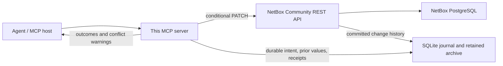

Direct-write NetBox MCP spike
=============================

This spike gives an agent **one MCP interface for editing NetBox, observing what happened, and requesting safe undo**. It calls NetBox's REST API directly. It does not wrap the official read-only MCP server or depend on a community writable MCP server.

The agreed recovery pattern is **optimistic concurrency**: if a field has changed again since the operation being undone, return a clear warning for a person to review. Preserve newer unrelated edits. Recheck the object's version at apply time so a concurrent edit cannot slip through the check.



**Objectives and guarantees.**

| Objective | Implemented contract | Boundary |
|---|---|---|
| Give agents the ability to make changes | `update_device` performs real REST PATCH requests using a restricted identity, a device allowlist, a field allowlist, and an ETag. No human approval step. | Device `description`, `serial`, and `status` only in this spike. |
| Guarantee observability of dispatched writes | Before dispatch, commit the task, operation key, desired change, exact prior values, inverse, and ETag to durable storage. Keep an append-only event record, HTTP receipt, and native committed evidence. Surface failed, no-op, uncertain, and unverified outcomes explicitly. | Requires functioning durable storage. REST and the local journal are not one atomic transaction. An unavailable receipt is reported as uncertainty, never invented success/failure. |
| Guarantee a clean undo path | Compute a deterministic inverse from saved evidence. Restore only the fields originally changed, record the correction as a new operation, and guard it with `If-Match`. Newer same-field edits produce a person-visible conflict warning. | A clean path means **safe correction or an explicit conflict with recovery evidence**, not unconditional overwriting of later work. Deleted objects, lost evidence, or incompatible server state block automatic undo. |

Every supported write has recovery data before it can reach NetBox. Unsupported operations are rejected before dispatch: arbitrary creates/deletes, IP allocation, relations, tags/custom-field maps, asset tags, arbitrary REST endpoints, force-undo, and redo are outside this spike. Asset tags are intentionally excluded because uniqueness can make restoring an old value depend on another object.

**What is built.** All runtime code is inside this folder and uses Python 3.11+ on Linux/POSIX with the standard library. It does not import the first spike's coordinator or SDK bridge. The folder contains the server, durable store, direct REST client, restricted lab setup helper, live contract tests, demonstration, journal, and saved evidence. License: MIT; NetBox and its deployment dependencies retain their own licenses.

- [Implementation and outcomes](RESULTS.md)
- [Development journal](JOURNAL.md)
- [Agent instructions](AGENT_INSTRUCTIONS.md)
- [Configuration example](config.example.json)
- [Server](direct_mcp/server.py), [write/recovery service](direct_mcp/service.py), and [durable store](direct_mcp/store.py)

**Run it against the existing synthetic lab.** The previous spike's rootless Podman NetBox must be running. These commands are from this folder:

```sh
# Optional: start the previously created lab if it was stopped.
python3 ../../lab/lab.py up
python3 ../../lab/lab.py ready

# Create two separate synthetic devices and a restricted API identity.
python3 setup_lab.py

# Run the server; an MCP host normally starts this command for you.
python3 run.py --config .state/config.json
```

For a brand-new checkout, bootstrap the original lab and fixtures first using its [lab instructions](../../lab/README.md). `setup_lab.py` is fixed to that synthetic lab, so it cannot accidentally provision users on another instance. The MCP server itself is independent: to use it elsewhere, supply your own config, private token file, compatible NetBox, instance/restore-lineage ID, actor username, and explicit device allowlist.

A generic MCP host configuration is:

```json
{
  "mcpServers": {
    "netbox-direct-write": {
      "command": "python3",
      "args": [
        "/absolute/path/to/spikes/direct-write-mcp/run.py",
        "--config",
        "/absolute/path/to/spikes/direct-write-mcp/.state/config.json"
      ]
    }
  }
}
```

This is a single-user stdio server; no additional listening network port or remote authentication service is introduced. Credentials are read by the server from a private file, never supplied in tool arguments. The sample lab identity has NetBox view/change permissions constrained to the two fixture devices and view access to native history. The application further restricts writable fields. Do not give the agent an unrestricted alternate write credential if this interface is intended to enforce its write policy.

**Agent workflow.**

1. `begin_task(purpose)` obtains a task ID.
2. `read_device(device_id)` returns supported values and an ETag.
3. `update_device(task_id, operation_key, device_id, expected_etag, changes)` attempts the write. Keep the same operation key and identical arguments when retrieving a lost result; changing the key is not a safe retry strategy.
4. `get_operation` / `get_task` returns authoritative outcomes and evidence IDs. If uncertain or unverified, call `reconcile`; this only reads history and never replays a mutation.
5. `preview_undo` explains whether the inverse is safe. `undo_operation` recomputes that check; an earlier preview is not a reusable authorization to overwrite.
6. `undo_task` compensates a task in reverse order and stops on conflicts or uncertainty. Call `reconcile` and resume if execution was interrupted. This is recorded partial compensation, not an atomic database rollback.

The remaining tools are `capabilities`, `get_device_history`, `observability`, and `recovery_bundle`. A recovery bundle supplies previous values, receipts, events, and native evidence even when live NetBox is unavailable. It explicitly does not authorize applying an unchecked inverse.

Example edit arguments (replace IDs and ETag with the values actually returned):

```json
{
  "task_id": "returned-task-id",
  "operation_key": "inventory-ticket-123-device-6",
  "device_id": 6,
  "expected_etag": "W/\"timestamp-returned-by-netbox\"",
  "changes": {"description": "Updated inventory description"}
}
```

A conflict produces a structured warning such as:

```json
{
  "status": "conflicted",
  "warning": "Newer edits affect the fields being undone. Review the conflicts; no write will be made.",
  "conflicts": [
    {"field": "description", "reason": "Current value differs", "expected": "B", "current": "C"}
  ],
  "inverse": {"description": "A"}
}
```

Both MCP text content and structured content carry the warning. The host should display it to the person, including the operation/change IDs. There is no email/notification integration in this spike. A person can inspect the conflict and decide whether a deliberate new edit is appropriate; the undo tools provide no force-overwrite flag.

**Outcome semantics.**

| State | Meaning / next action |
|---|---|
| `prepared` | Intent/inverse is durable; dispatch was not durably entered. Under the exclusive process lock, reconciliation can close an abandoned preparation as failed without sending anything. |
| `dispatched` / `uncertain` | The request may have committed. Reconcile; no automatic mutation retry. Further edits to that device are blocked while unresolved. |
| `applied_unverified` | A successful HTTP receipt exists, but committed native evidence has not yet been verified. Recovery data remains available; further edits wait for reconciliation. |
| `applied` | Matching actor, object, operation marker, request ID where available, and before/after native evidence verified. This describes the historical operation, not a promise that the object still has those values now. |
| `no_change` | No effective field change. A local no-op is journaled without PATCH; no native history row is required. |
| `failed` | A definitive server rejection, or an abandoned pre-dispatch preparation. Inspect the recorded reason. |

Generic tool errors are not proof that a write did not happen. Use the task/operation key to inspect the ledger and reconcile. Likewise, `already_undone` is an idempotent historical receipt; it does not overwrite edits made after the correction.

**Observability and retention.** `observability` returns outcome counts, unresolved IDs, archive freshness/missing IDs, event counts (including archive failures), and integrity status. Event/history tables reject normal updates/deletes. Hash chains and projection checks detect accidental rewriting or divergence; they are not protection against an administrator replacing the database and hashes together. No age-based purge is implemented.

The archive uses full, replayable native-history scans and preserves stable snapshot fields rather than mutable expanded object references. Missing/changed previously archived native records block writes and recovery pending investigation. A successful scan is an observation at a point in time, not a mathematical proof against undiscovered concurrent pruning; NetBox retention and complete history access are prerequisites.

Create an independent backup or JSON export (new destination paths only):

```sh
python3 run.py --config .state/config.json --backup .state/journal-backup.sqlite
python3 run.py --config .state/config.json --export .state/journal-export.json
```

The SQLite backup contains the journal and archive together. JSON exports have SHA-256 sidecars. Back up the config's instance identity as well, and reconstruct credentials separately. **Never run original and restored copies as independent active writers against the same instance:** that splits idempotency state. The tests restore a stopped copy for a controlled recovery exercise.

Keep the durable journal volume and its backups indefinitely, outside the application's failure domain in a real deployment. Retain NetBox history with `CHANGELOG_RETENTION=0`. Assign a new instance/restore lineage when the database is rewound or IDs can be reused; a mismatched config is rejected. NetBox upgrades can change history serialization, as the earlier spike demonstrated, so preserve original exports and explicitly validate migrations.

**Validation and repeatability.**

```sh
python3 tests/test_live.py
python3 demo.py
```

The tests and demo mutate only the two allowlisted synthetic fixture devices. Do not run them concurrently: they deliberately simulate independent writers and reset fixture fields. Every test gets a separate journal; raw artifacts are under `evidence/`, private configs/databases under ignored `.state/`. The demonstration uses actual stdio MCP calls and leaves a write-and-undo transcript.

The server currently gates writes to NetBox 4.6.10 and 4.7.1, whose detail ETag behavior was exercised in the first spike. This spike's complete acceptance suite runs on 4.6.10. No plugins are part of the contract. Expanding the version/model/field set requires rerunning concurrency and recovery tests.

**Operating assumptions and limits.** SQLite must reside on reliable local storage with normal fsync and locking semantics; all server processes for this instance must share the same journal. Native history must be complete and retained, and the configured actor must match the API token. NetBox must enforce detail `If-Match` under its transaction lock. The local filesystem and NetBox administration remain trusted.

A process can die after recording dispatch but before sending the request: without a matching native record, reconciliation cannot distinguish that from a lost response to a delayed request. The tool keeps that uncertainty explicit and retains the preimage; it does not guess. Eliminating that gap for every request requires transactional server-side command receipts, which a REST-only MCP client cannot supply.

Recovery covers the supported NetBox fields. It does not retract webhooks, reverse physical device changes, undo arbitrary deleted graphs, or recover from loss of all journal/backup copies. This is an executable spike with bounded, tested guarantees—not a production multi-user service or a claim of unconditional recovery under every failure.

The [NetBox REST API](https://netboxlabs.com/docs/netbox/integrations/rest-api/) supplies reads/writes; [ObjectChange](https://netboxlabs.com/docs/netbox/models/core/objectchange/) supplies native committed history. All primary components are open source; no paid service is needed.
